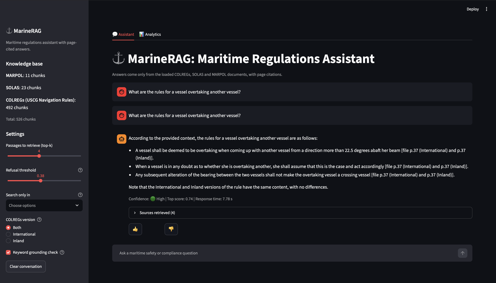
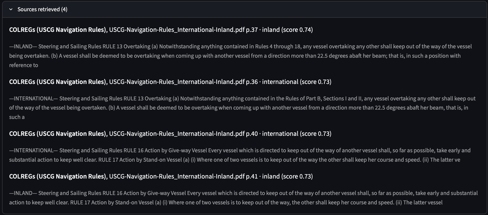
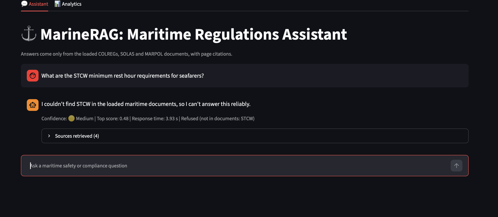
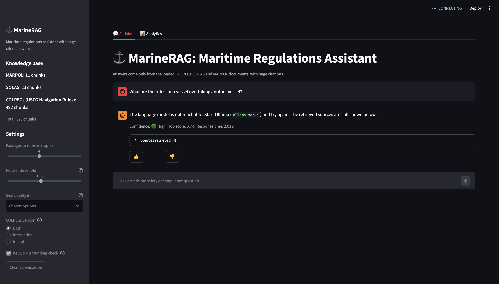
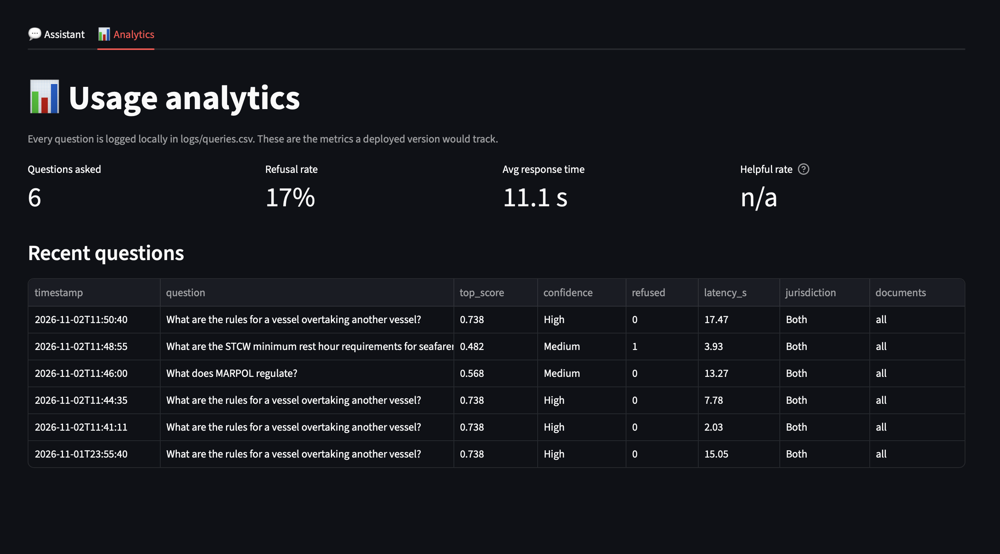
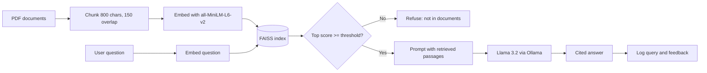

# ⚓ MarineRAG: Maritime Regulations Assistant

A Retrieval-Augmented Generation (RAG) assistant that answers maritime safety questions from **COLREGs, SOLAS and MARPOL** documents. Every answer carries **page-level citations**, and the assistant **refuses to answer** when the documents do not contain the answer instead of guessing.

Runs fully **locally and offline** (no API keys, no cloud) using Ollama, which matters for ships with limited connectivity.

## Demo

| Cited answer | Retrieved sources |
|---|---|
|  |  |

| Refusal when out of scope | Filters and settings |
|---|---|
|  |  |

| Usage analytics | Evaluation output |
|---|---|
|  |  |

## Features

- **Page-cited answers** from the loaded regulation PDFs
- **Refusal mode**: a similarity threshold stops the model from answering questions the documents cannot support
- **Confidence indicator** (High / Medium / Low) for every answer
- **Keyword grounding guard**: refuses when a named term in the question (for example STCW) does not appear anywhere in the retrieved passages, which catches maritime questions the documents do not cover
- **Document filter**: search only COLREGs, SOLAS or MARPOL
- **Jurisdiction filter**: the USCG manual prints International and Inland rules side by side, so the user can pick one version
- **Chat interface** with example questions, conversation history and adjustable top-k and threshold
- **Feedback buttons** (👍 / 👎) and an **analytics tab** (questions, refusal rate, response time, helpful rate)
- **Evaluation script** with Hit@1, Hit@4, MRR, off-topic refusal test, hard negatives (guard off vs on) and a threshold sweep

## Architecture



## Tech stack

Python · sentence-transformers (`all-MiniLM-L6-v2`) · FAISS · pypdf · Ollama (`llama3.2`) · Streamlit

## Quick start

```bash
git clone https://github.com/Kunal-Chauhan-0806/MarineRAG.git
cd MarineRAG
python3 -m venv venv
source venv/bin/activate
pip install -r requirements.txt
ollama pull llama3.2
mkdir -p data    # add your COLREGs / SOLAS / MARPOL PDFs here
streamlit run app.py
```

The PDFs are not stored in this repository. Use text-based (not scanned) PDFs, for example the USCG Navigation Rules (International and Inland) and the IMO convention summaries.

## Evaluation

```bash
python3 eval.py
```

Results on the 20 answerable questions: **Hit@1 20/20, Hit@4 20/20, MRR 1.000** (COLREGs 12/12, SOLAS 4/4, MARPOL 4/4). All **8/8** off-topic questions were refused at a threshold of 0.38 (highest off-topic score 0.37, lowest valid score 0.40).

**Finding:** the similarity threshold alone refused **0/4 hard negatives** (maritime questions that the documents do not cover, such as STCW and ISM), because they scored 0.48 to 0.70. A threshold cannot separate "same topic area" from "answerable from these documents". This motivated the keyword grounding guard; `eval.py` reports hard negatives with the guard off and on. Results are saved to `results/eval_results.csv`.

## Project structure

```
rag.py          chunking, embeddings, FAISS retrieval, grounded generation
app.py          Streamlit chat app with filters and analytics tab
analytics.py    query and feedback logging, usage statistics
eval.py         retrieval and refusal evaluation
docs/           business case and screenshots
```

## Known limitations

- Knowledge base is unbalanced: the COLREGs manual is full length, while the SOLAS and MARPOL files are short summaries
- The refusal threshold sits close to some valid questions, and maritime questions outside the documents can score high. The keyword guard only works for named terms (acronyms and capitalised words), so a lowercase or paraphrased out-of-scope question can still slip through
- The jurisdiction filter relies on section markers in the PDF text, so chunks without a marker are treated as neutral
- A 3B local model follows citation instructions less reliably than a larger model
- Educational prototype: **not** a substitute for the official consolidated IMO texts

## Business case

See [docs/BUSINESS_CASE.md](docs/BUSINESS_CASE.md) for the market, users, revenue model and risks.

## Author

Kunal Chauhan, B.Tech Computer Engineering + MBA (Tech), Mumbai
